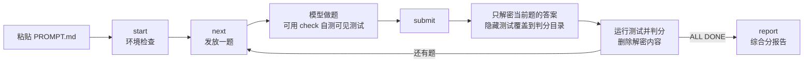

<div align="center">

# 🧪 litmus

**粘贴一段提示词，让大模型在你自己的 Agent 工具里做完 61 道编程题，拿回一个由脚本判出来的综合分。**

[](LICENSE)
[](#环境要求)
[](#为什么是-litmus)
[](#环境要求)

</div>

新模型发布了，值不值得换？公开榜单测的是厂商的跑分环境，不是你手上的 Claude Code、Codex 或 OpenCode。litmus 把测试搬进你自己的工具里：**同一套题、同一个顺序、同一把尺子**，不同模型的报告直接放在一起比。

## 为什么是 litmus

- **🎯 测你真正在用的东西**：在你日常用的 Agent 工具里、按你当前的配置跑，测的是"这个工具 + 这个模型"的真实组合，不是厂商的理想环境。
- **⚖️ 判分不靠模型**：代码题跑隐藏测试，答案题和标准答案逐项比对，全部由脚本完成，不用大模型当裁判，同一份答案永远得同一个分。
- **🔒 答案偷看不到、改不了分**：隐藏测试和参考解全部加密，每题只能交一次、交完不告诉对错；改动判分代码或题目，成绩直接标为无效。
- **📊 一个数就能比**：综合分 = 正确性 × 效率，耗时和 token 用量自动从工具的会话日志里读出来，不用手工记录。
- **📦 零依赖，一个目录装下全部**：只用 Python 标准库，没有服务端，`git clone` 下来就能测，不用 `pip install`。

## 快速开始

```bash
git clone https://github.com/ming2363/litmus.git
```

1. 用 Agent 工具在 `litmus` 目录里**开一个新会话**，选好要测的模型。
2. 把工具设成**自动批准命令**，否则每条命令都会停下来等你点同意：
   - Claude Code：auto 或 bypass 权限模式
   - Codex：`--full-auto`，或把审批策略设成 never
   - OpenCode：把权限设成 allow
3. 把 [`PROMPT.md`](PROMPT.md) 里的提示词整段复制给模型。时间紧就用其中的"快速版"（21 题）。
4. 等它出现 `ALL DONE`，终端会给出综合分摘要。用浏览器打开 `reports/` 下的 HTML 报告看完整结果（同时还有 Markdown 和 JSON 各一份）。

中途断了也不要紧：原会话里说"继续"；会话没了就开新会话、重新粘贴提示词，`start` 会接着上次的进度做。

## 报告长什么样

主报告是一个 HTML 文件，断网也能打开，浅色、深色和手机屏幕都能正常显示。最上面是综合分，下面依次是分项得分、各维度和各难度的通过率（附 95% 置信区间）、token 用量和逐题明细。逐题表可以按状态和维度筛选、点表头排序，失败原因默认收起。

同样的内容也写成 Markdown，开头是这样的：

```text
## 综合分：63.92
- 正确性分：66.67 | 时间分：0.85 | token 分：0.81 | 效率系数：0.96

## 逐题明细
| 序号 | 题号 | 维度 | 难度 | 状态 | 得分比例 | 可合入性否决 | 耗时(s) | 参考(min) | r | 时间得分 | 计费等价 token | token 得分 | 备注 |
|---|---|---|---|---|---|---|---|---|---|---|---|---|---|
| 1 | bug-py-01 | bug | easy | pass | 100% | 否 | 450.0 | 15 | 0.50 | 1.00 | 30000 | 1.00 | - |
```

报告里还记录了工具名、模型 ID、题库版本、litmus 提交号、JDK / Python 版本、中途续跑记录，以及成绩是否有效。**只有题库版本和模式都相同的两份报告，综合分才能直接比较。**

## 测什么

61 道题全部原创，覆盖 7 个维度，题型参考了公开榜单的思路：

| 维度 | 题数 | 快速模式 | 题型参考 | 交付形式 |
|---|---:|---:|---|---|
| 修 Bug | 12 | 3 | SWE-bench | 改代码 |
| 新功能 / 跨文件改动 | 9 | 3 | FeatureBench | 改代码 |
| 终端实操 | 8 | 3 | Terminal-Bench | 改工作目录里的文件 |
| 工具调用 | 8 | 3 | BFCL / τ-bench | `answer.json` |
| 读代码 | 8 | 3 | RULER / MRCR | `answer.json` |
| 小范围编辑 | 8 | 3 | Aider | 改代码 |
| Code Review | 8 | 3 | — | `review.json` |
| **合计** | **61** | **21** | | |

- 语言：修 Bug、新功能、小范围编辑、读代码、Code Review 五个维度 Python 23 题、Java 22 题；终端实操和工具调用共 16 题，不限语言。
- 难度：易 15、中 30、难 15，另有 1 道**长任务**：在真实开源项目（Python-Markdown）上实现一个完整功能，要通过 52 条新功能测试，同时不能弄坏原有的 1016 条测试。
- 题目顺序固定，所有模型按同一顺序做。

## 怎么算分

```
综合分 = 正确性分 × 效率系数
```

| 分项 | 怎么算 |
|---|---|
| **正确性分**（0～100） | 按难度加权的得分率，权重：易 1、中 2、难 3、长任务 6。长任务没全过时按新功能测试的通过比例给部分分，但只要弄坏一条原有测试就得 0 |
| **效率系数**（0.75～1.00） | `0.75 + 0.15 × 时间分 + 0.10 × token 分`。只算拿到分的题，"又快又错"拿不到效率分 |
| **时间分** | 实际耗时 ÷ 参考时长 = r。r ≤ 1 得 1；超出时得 `max(0.6, 1 − 0.2 × log2 r)`，慢一倍得 0.8，最低 0.6 |
| **token 分** | 计费等价 token（缓存读取按 0.1 计）对比各难度预算；超出时得 `max(0.5, 1 − 0.25 × log2(用量 ÷ 预算))` |

正确性决定综合分的至少 75%。慢一点但做对了，最多只损失十来分，不会被判成不及格。完整规则见 [设计文档 6.1 节](docs/design.md#61-综合分)。

token 用量从这些工具的本地会话日志中自动读取，其他工具这一项显示"未采集"，效率系数改为只看时间：

| 工具 | 日志位置 |
|---|---|
| Claude Code | `~/.claude/projects/`（含子代理日志） |
| Codex | `~/.codex/sessions/` |
| OpenCode | `~/.local/share/opencode/opencode.db`（只读打开） |

## 判分流程



代码题按顺序检查：

1. **可合入性**：只改了允许的文件、没动可见测试、能编译、改动行数不超上限，任一项不满足直接判不通过。
2. **隐藏测试**：F2P 用例（原来失败、应该修好）全部通过，P2P 用例（原来通过、不能改坏）也全部通过，这题才算通过。
3. **隔离运行**：测试运行器来自 litmus 自身，以 `python3 -I -S -B` 启动，本机装的第三方包不会影响结果。

## 防作弊

| 风险 | 怎么处理 |
|---|---|
| 模型偷看答案 | `answers/` 里全是密文；`submit` 只解密当前这一题，判完立刻删除 |
| 反复试错刷分 | 每题只能提交一次，提交后不反馈对错 |
| 篡改判分代码或测试 | `start` 记下提交号，`submit` 和 `report` 都会校验，不一致成绩标为**无效** |
| 在工作目录伪造测试运行器 | 判分只用 litmus 自带的运行器 |
| 仓库里的 `AGENTS.md` / `CLAUDE.md` 干扰做题 | 仓库任何位置都不允许出现这类文件，`start` 和 `lint` 都会检查 |
| Code Review 每行都提意见刷命中 | 每题最多 10 条，命中还要求类别正确 |
| 只做一部分就结束 | 没提交的题一律按不通过计分 |

**它不防什么**：解密密钥写在 litmus 源码里。模型如果刻意写代码自己解密，或者去翻出题时的会话记录，是防不住的。加密要挡的是"扫一眼就看到答案"和"公开题库被爬进训练数据"，而不是刻意作弊。

## 命令一览

做题端（被测模型使用）：

| 命令 | 作用 |
|---|---|
| `python3 litmus.py start [--quick] [--new]` | 环境检查，新建或续跑一次测评；`--new` 放弃未完成的测评重新开始 |
| `python3 litmus.py next` | 发放下一题 |
| `python3 litmus.py check` | 自测当前题的可见测试或答案格式（不判分） |
| `python3 litmus.py submit` | 提交并判分当前题 |
| `python3 litmus.py skip` | 放弃当前题，按不通过计分 |
| `python3 litmus.py status` | 查看进度 |
| `python3 litmus.py report` | 汇总成绩，写入 `reports/`（HTML、Markdown、JSON），终端只显示摘要 |

出题端（维护题库用，测评进行中会拒绝运行）：

| 命令 | 作用 |
|---|---|
| `python3 author.py unseal <题号>` | 解密答案用于修改 |
| `python3 author.py seal <题号>` / `--all` | 加密答案并删除明文 |
| `python3 author.py selftest [题号]` | 起始代码必须失败、参考解必须通过，各跑 3 次确认稳定 |
| `python3 author.py lint` | 检查禁止文件、manifest 与题目目录是否一致 |

## 环境要求

- macOS 或 Linux
- Python ≥ 3.9（只用标准库）
- JDK ≥ 17（需要 `javac` 和 `java`，Java 题用）
- git
- 能执行命令、能改文件的 Agent 工具，并设为自动批准命令。纯网页聊天测不了

## 目录结构

```text
litmus/
├── PROMPT.md       # 测评提示词：每次复制给被测模型
├── litmus.py       # 做题入口
├── author.py       # 出题入口
├── litmus/         # 判分、加解密、报告、token 解析
├── tasks/          # 题面 + 起始代码（明文）
├── answers/        # 隐藏测试、标准答案、参考解（全部加密）
├── docs/           # 设计文档与出题规范
├── tests/          # litmus 自身的测试
├── runs/           # 测评过程数据（git 忽略）
└── reports/        # 测评报告（git 忽略）
```

## 参与出题

出题流程、质量要求、各判分器的文件格式和难度标准见 [docs/task-authoring.md](docs/task-authoring.md)，整体设计见 [docs/design.md](docs/design.md)。新题提交前需要通过：

```bash
python3 author.py lint
```

```bash
python3 author.py selftest
```

litmus 自身的测试：

```bash
python3 -m unittest discover -s tests -t .
```

## 路线图

- [x] 7 个维度 60 题题库、5 种判分器、加密与防篡改
- [x] 综合分（正确性 × 效率），Claude Code / Codex / OpenCode token 自动采集
- [x] 长任务与部分得分
- [ ] 题库加难：第一版题目对前沿模型区分度不够，正在按"长任务 + 真实开源仓库"的方向重出
- [ ] 同一模型多次测评合并，计算 pass^k 和稳定性
- [ ] 支持更多 Agent 工具的会话日志
- [ ] 题目定期轮换

## 许可证

litmus 以 [Apache License 2.0](LICENSE) 开源。

长任务 `tasks/long-py-01/repo/` 中的代码来自 [Python-Markdown](https://github.com/Python-Markdown/markdown)，按 BSD 3-Clause 许可证使用，版权与许可条款见该目录下的 [LICENSE.md](tasks/long-py-01/repo/LICENSE.md)。
